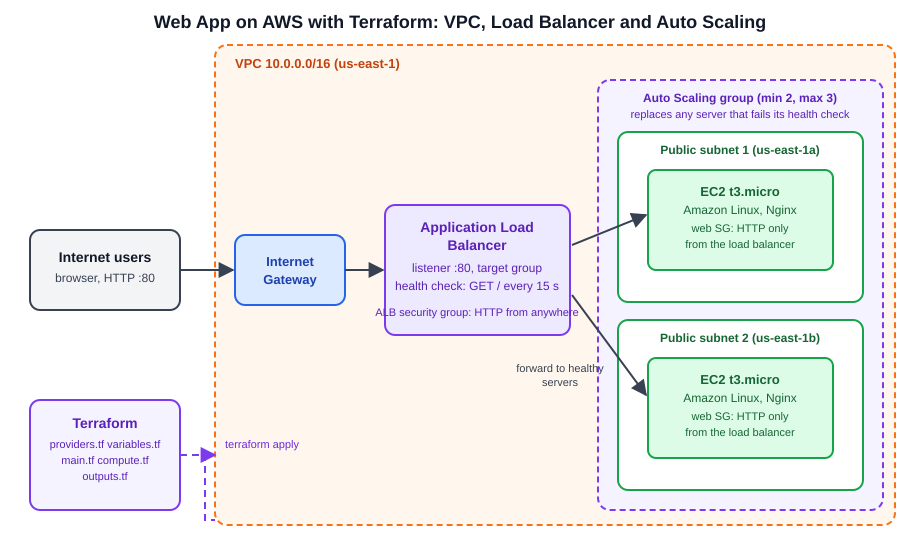
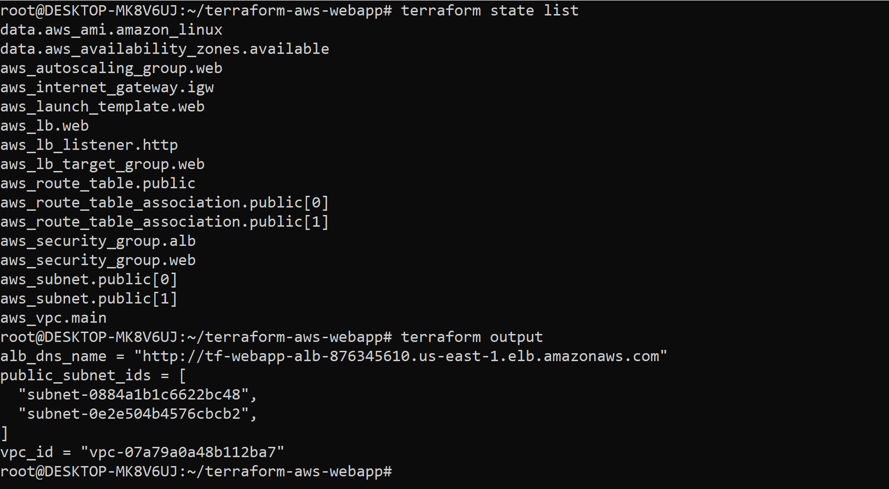
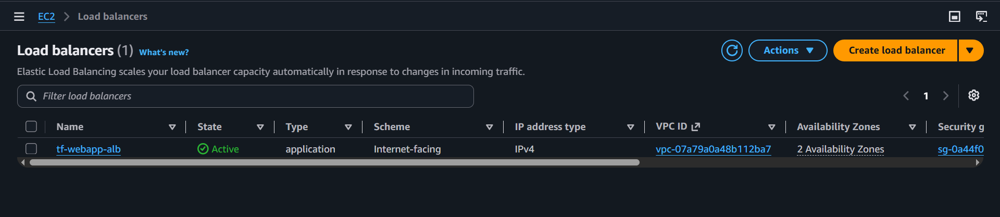
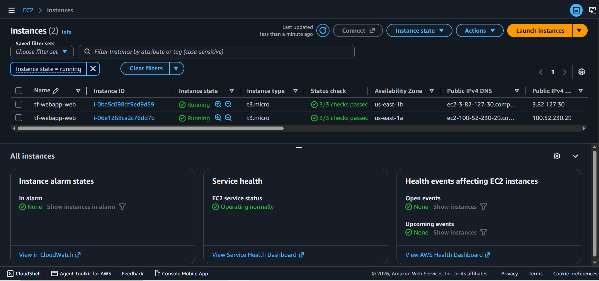
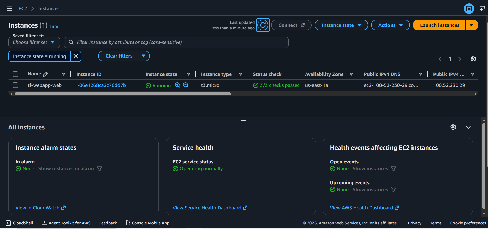
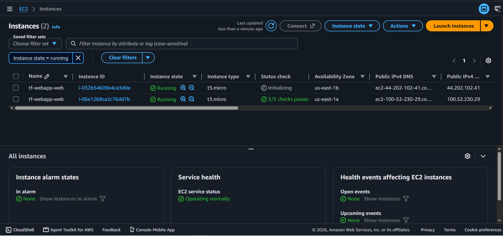

# Web App on AWS with Terraform: VPC, Load Balancer and Auto Scaling

A small web application on AWS that is created entirely from code. One `terraform apply` builds a network, a load balancer and an Auto Scaling group of two Nginx servers, and one `terraform destroy` removes everything again.



## What it builds

| Resource | Purpose |
|---|---|
| VPC (10.0.0.0/16), internet gateway, route table | The network |
| 2 public subnets in different Availability Zones | Places for the servers, so one zone failing does not take the site down |
| Security group for the load balancer | Allows HTTP (port 80) from the internet |
| Security group for the web servers | Allows HTTP **only from the load balancer**, so the servers are not directly exposed |
| Launch template | The recipe for each server: Amazon Linux, `t3.micro`, and a startup script that installs Nginx and writes a page showing the server's name |
| Application Load Balancer, target group and listener | Receives traffic on port 80 and sends it only to healthy servers (health check: `GET /` every 15 seconds) |
| Auto Scaling group (min 2, max 3, desired 2) | Keeps two servers running across both subnets and replaces any that fail their health check |

## Terraform files

| File | Contents |
|---|---|
| `providers.tf` | Terraform and AWS provider versions, and the region |
| `variables.tf` | Region, project name, VPC range and instance type |
| `main.tf` | VPC, subnets, internet gateway and routing |
| `compute.tf` | Security groups, launch template, load balancer and Auto Scaling group |
| `outputs.tf` | VPC ID, subnet IDs and the load balancer URL |

## How to use it

**Requirements:** Terraform 1.5 or newer, the AWS CLI configured with credentials for an IAM user (`aws configure`), and an AWS account.

```bash
git clone https://github.com/kedarg96/terraform-aws-webapp.git
cd terraform-aws-webapp
terraform init
terraform plan
terraform apply
```

When the apply finishes, Terraform prints `alb_dns_name`. Open that URL in a browser (after about 3 to 5 minutes, once the servers pass their health checks) and refresh a few times. The "Served by" line switches between the two servers.

```bash
terraform output -raw alb_dns_name
```

**Remove everything when you are done**, because the load balancer is billed by the hour while it exists:

```bash
terraform destroy
```

Variables such as the region (`us-east-1` by default) and the instance type (`t3.micro`) can be changed in `variables.tf`.

## Screenshots

### 1. What Terraform manages
`terraform state list` shows the resources Terraform created, and `terraform output` shows the values it prints.



### 2. The load balancer is active


### 3. Traffic is shared between two servers
Refreshing the load balancer URL returns a page from one server, and then from the other.


### 4. Self-healing
Two servers are running:



I terminated one server by hand. One remains:



The Auto Scaling group launches a replacement in the same zone as the terminated server (us-east-1b), which starts initializing:



## Design decisions

- **Two Availability Zones.** The servers are spread over two subnets in different zones, and the load balancer spans both.
- **Servers only reachable through the load balancer.** The web security group accepts traffic from the load balancer's security group, not from the internet.
- **Health checks at the load balancer.** The Auto Scaling group uses the load balancer's health check (with a 120 second grace period), so a server that is running but not serving pages is replaced.
- **No hard-coded values.** The AMI is looked up with a data source, the Availability Zones are looked up too, and the subnet ranges are calculated with `cidrsubnet`.
- **Everything in code.** Nothing was created by hand in the console, apart from terminating a server to test self-healing.

## Limitations and next steps

- The site uses HTTP only. Production would add HTTPS with an ACM certificate.
- The servers sit in public subnets so the project needs no NAT gateway (which costs extra). Production would use private subnets with a NAT gateway.
- Terraform state is stored locally. A team setup would use a remote backend such as S3 with state locking.
- Scaling is fixed at two servers. A scaling policy driven by CPU or request count would add and remove servers automatically.
- The configuration could be split into modules (network, compute) to make it reusable.

## Author

Kedar Gokhale
